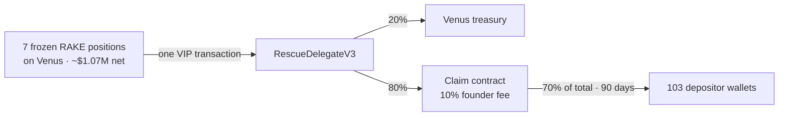

# RAKE × Venus: returning frozen funds to depositors



| File | What it is |
|---|---|
| [PROPOSAL.md](PROPOSAL.md) | The proposal to Venus |
| [APPENDIX.md](APPENDIX.md) | Technical appendix A1–A5 |
| [addresses.json](addresses.json) | Every address the VIP touches |
| [data/depositor_share_of_each_frozen_pool.csv](data/depositor_share_of_each_frozen_pool.csv) | What each of the 103 wallets can claim: its % of each frozen pool |
| [data/depositor_2021_rake_compensation.csv](data/depositor_2021_rake_compensation.csv) | What each wallet already received in RAKE in 2021, against its frozen value |
| [data/README.md](data/README.md) | What every column in those two files means |
| `contracts/src/` | The two contracts: `RescueDelegateV3` (one per market) and `RakeStuckFundsClaim` |
| `contracts/script/RescueAmounts.s.sol` | Read-only: each position's net value and the 20/10/70 split, live from BSC |
| `contracts/script/DeployRakeStuckFundsClaim.s.sol` | Step 1, RAKE: deploys the claim contract, records it in `addresses.json` |
| `contracts/script/DeployRescueDelegates.s.sol` | Step 2, Venus: deploys the 7 rescue delegates bound to that claim contract, records them |
| `contracts/script/VenusRescueProposal.s.sol` | Step 3, Venus: prints the proposal Venus submits: targets, values, signatures, calldatas |
| `contracts/script/libraries/` | Shared by scripts and tests: the addresses, the deployment, the proposal's command list |
| `contracts/test/` | One test file per script and per contract, same name |
| Claim site | https://claim-frontend-one.vercel.app |

```
cd contracts && forge install foundry-rs/forge-std --no-git
export BSC_RPC_URL=<BSC archive RPC>
forge script script/RescueAmounts.s.sol --fork-url $BSC_RPC_URL           # what moves, and to whom
forge script script/DeployRakeStuckFundsClaim.s.sol --fork-url $BSC_RPC_URL   # RAKE deploy, dry run (needs $PRIVATE_KEY)
forge script script/DeployRescueDelegates.s.sol --fork-url $BSC_RPC_URL       # Venus deploy, dry run (needs $PRIVATE_KEY)
forge script script/VenusRescueProposal.s.sol --fork-url $BSC_RPC_URL     # the proposal's commands
forge test --match-contract RakeStuckFundsClaimTest                       # no RPC
forge test                                                                # all, on a BSC fork
```
