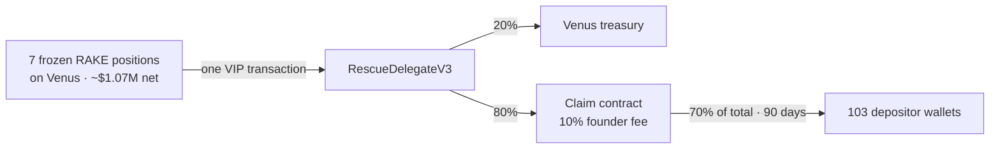

# RAKE × Venus: returning frozen funds to depositors



| File | What it is |
|---|---|
| [PROPOSAL.md](PROPOSAL.md) | The proposal to Venus |
| [APPENDIX.md](APPENDIX.md) | Technical appendix A1–A5 |
| [addresses.json](addresses.json) | Every address the VIP touches |
| [data/ENTITLEMENTS.csv](data/ENTITLEMENTS.csv) | Each wallet's % of each pool |
| [data/wallet_master.csv](data/wallet_master.csv) | 2021 compensation, one row per wallet |
| `contracts/` | Foundry project: the rescue contract, the claim contract, tests |
| `scripts/` | Read-only scripts that reproduce every figure from the chain |
| Claim site | https://claim-frontend-one.vercel.app |

```
cd contracts && forge install foundry-rs/forge-std --no-git
forge test --match-contract RakeStuckFundsClaimTest          # no RPC
FORK_BLOCK=131573400 BSC_RPC_URL=<BSC archive RPC> forge test                # all 35
```
