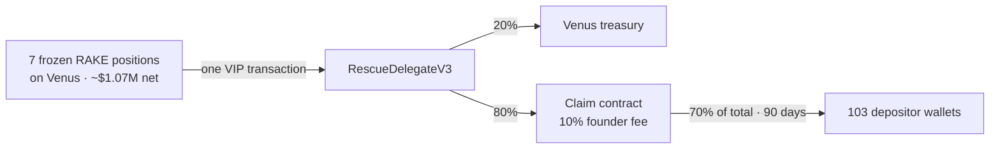

# RAKE × Venus: returning frozen funds to depositors



| File | What it is |
|---|---|
| [PROPOSAL.md](PROPOSAL.md) | The proposal to Venus |
| [APPENDIX.md](APPENDIX.md) | Technical appendix A1–A5 |
| [addresses.json](addresses.json) | Every address the VIP touches |
| [data/ENTITLEMENTS.csv](data/ENTITLEMENTS.csv) | Each wallet's % of each pool |
| [data/wallet_master.csv](data/wallet_master.csv) | 2021 compensation, one row per wallet |
| `contracts/src/` | The two contracts: `RescueDelegateV3` (one per market) and `RakeStuckFundsClaim` |
| `contracts/script/RescueAmounts.s.sol` | Read-only: each position's net value and the 20/10/70 split, live from BSC |
| `contracts/script/DeployRescueContracts.s.sol` | Deploys the claim contract + 7 rescue delegates, records them in `addresses.json` |
| `contracts/script/VenusRescueProposal.s.sol` | Prints the proposal Venus submits: targets, values, signatures, calldatas |
| `contracts/test/` | One test file per script and per contract, same name |
| Claim site | https://claim-frontend-one.vercel.app |

```
cd contracts && forge install foundry-rs/forge-std --no-git
export BSC_RPC_URL=<BSC archive RPC>
forge script script/RescueAmounts.s.sol --fork-url $BSC_RPC_URL           # what moves, and to whom
forge script script/DeployRescueContracts.s.sol --fork-url $BSC_RPC_URL   # deploy dry run (needs $PRIVATE_KEY)
forge script script/VenusRescueProposal.s.sol --fork-url $BSC_RPC_URL     # the proposal's commands
forge test --match-contract RakeStuckFundsClaimTest                       # no RPC
forge test                                                                # all, on a BSC fork
```
