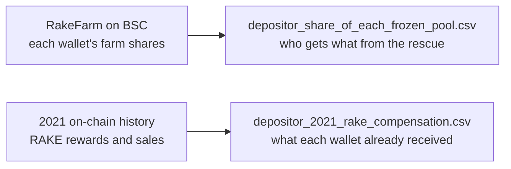

# Data

## depositor_share_of_each_frozen_pool.csv

One row per depositor wallet (103). This is what each wallet can claim from the rescued funds.

| Column | Meaning |
|---|---|
| Depositor wallet address | The wallet that deposited into RAKE; only it can claim |
| % of the frozen *TOKEN* pool this wallet owns | Its farm shares ÷ all shares in that pool. It receives this % of that token after fees. Each column sums to 100% |

## depositor_2021_rake_compensation.csv

One row per wallet that ever had funds in the frozen pools (113; the 103 above still do). It shows the RAKE each wallet earned and sold in 2021, against the value still frozen.

| Column | Meaning |
|---|---|
| Frozen Venus markets this wallet deposited in | The frozen markets it used (vBUSD, vBTC, …) |
| Still has deposits frozen today | `yes` = it is one of the 103 claimants |
| Frozen deposit value in USD | Its frozen funds at 24 July 2026 prices (BSC block 114,966,322) |
| RAKE earned … / Value of that RAKE … | RAKE rewards earned from the frozen pools, and their BNB / USD value at the time, over two periods: the first 7 days, and up to 25 March 2021 |
| RAKE earned from all RAKE pools | The same, counting every RAKE pool rather than only the frozen ones |
| RAKE sold / BNB and USD received | What the wallet actually sold on DEXes up to 25 March 2021, and for how much |
| Coverage … | Compensation ÷ frozen deposit value. 1.0 = fully compensated, above 1.0 = received more than is frozen |
| Never sold any RAKE | `yes` = held all its RAKE |
